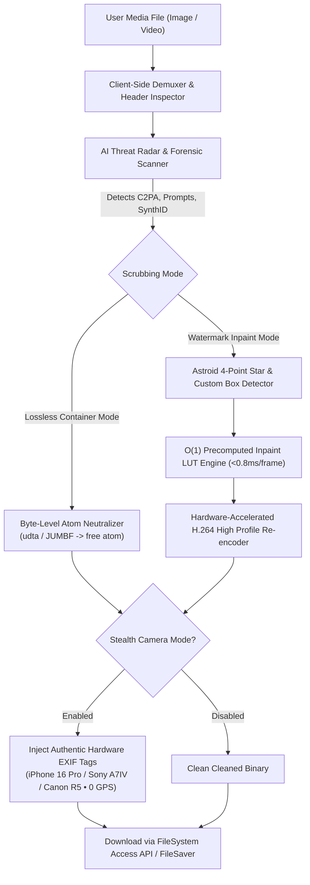

<p align="center">
  
</p>

<h1 align="center">GhostMeta AI 🛡️</h1>

<p align="center">
  <strong>100% Client-Side AI Metadata Remover, Cryptographic C2PA Stripper & Watermark Inpainter for Images & Videos</strong>
</p>

<p align="center">
  <a href="https://ghostmeta-ai.vercel.app"></a>
  
  
  
  <a href="LICENSE"></a>
</p>

---

## ⚡ Overview

**GhostMeta AI** is an offline-first, client-side forensic privacy tool designed to strip AI-generated provenance, cryptographically signed C2PA credentials, generative prompts, ComfyUI node graphs, Google SynthID watermarks, and visible corner logos from photos and videos.

**Zero Cloud Uploads • Zero Data Retention • 100% In-Browser Execution**

---

## 🌟 Key Features

### 🛡️ 1. Cryptographic C2PA & Provenance Eradication
- **C2PA / CAI Credentials**: Neutralizes JUMBF manifests, cryptographic assertion signatures, and claim generator certificates injected by OpenAI (ChatGPT, DALL·E 3, Sora), Adobe Content Credentials, and Microsoft Copilot.
- **Google DeepMind (Gemini / Imagen / Veo)**: Strips IPTC `digitalSourceType` (`trainedAlgorithmicMedia`) and wipes SynthID provenance tags.
- **Midjourney & Stable Diffusion**: Eliminates hidden prompts, negative prompts, job seeds, model hashes, and complete ComfyUI JSON node trees from PNG chunks (`tEXt`, `zTXt`, `iTXt`).

### 🔮 2. Astroid 4-Point Star Hypocycloid Watermark Inpainter
- Specialized mathematical detector for Google Gemini, Veo, and Imagen 4-pointed star badges:
  $$\left(\frac{|dx|}{R}\right)^{0.65} + \left(\frac{|dy|}{R}\right)^{0.65} \le 1.0$$
- Evaluates **4-fold geometric symmetry** (`asymmetry < 22`) to avoid false positives on sidewalk cracks, floor textures, or clothing seams.
- Inpaints watermark regions seamlessly using surrounding texture with zero full-frame quality degradation.

### 🎯 3. Interactive Multi-Box Selector & Video Motion Tracker
- **Custom Bounding Boxes**: Draw custom boxes over any watermark or logo anywhere on the screen.
- **Moving Watermark Tracking (Sora / Kling / Runway)**: Track moving AI watermarks across video frames with an interactive video scrubber.
- **Precomputed O(1) Inpaint LUT**: Inpainting schedule executes in `< 0.8ms` per frame for stutter-free native 60fps playback.

### 📷 4. Stealth Camera Mode (Authentic EXIF Hardware Spoofer)
- Social media algorithms (Instagram, TikTok, LinkedIn) often flag or downrank 100% blank metadata files as "scrubbed/synthetic".
- **Stealth Camera Mode** replaces erased AI tags with genuine camera and lens profiles **without GPS location coordinates**:
  - 📱 **Apple iPhone 16 Pro** (24mm f/1.78, ISO 64, Apple iOS 18.1)
  - 📷 **Sony Alpha A7 IV** (FE 24-70mm f/2.8 GM II, sRGB, uncompressed raw color profile)
  - 🎥 **Canon EOS R5** (RF 50mm f/1.2L USM, Cinema gamut tags)

### ⚡ 5. Dual Cleaning Engines
| Engine Mode | Best For | Mechanism | Quality Impact |
| :--- | :--- | :--- | :--- |
| **Lossless Container Stripper** | Metadata, C2PA & Prompts only | Surgical byte replacement (`free` atoms, byte offset fixing) in `< 50ms` | **100% Bit-for-Bit Identical** (Exact byte size preserved) |
| **Deep Canvas & High-Bitrate Inpaint** | Visible Watermarks & SynthID Jitter | Full-resolution frame canvas inpainting + H.264 High Profile Level 4.0 (`avc1.640028`) | **Visually Lossless** (Smart VBR compression) |

### ✨ 6. Side-by-Side "Compare Corner Fix" Modal
- Zoomed-in pixel-by-pixel inspector showing the original watermark next to the healed corner with exact inpainted pixel count metrics.

### 📱 7. PWA Offline-First & Mobile Wi-Fi Connect
- Scan the on-screen QR code to open and install GhostMeta AI on Android (Chrome PWA) or iOS (Safari Home Screen).
- Runs 100% offline via local Service Worker caching.

---

## 🏗️ Architecture & Pipeline



---

## 🔍 Supported Formats & AI Forensics Matrix

| Platform / Model | Detected Signatures | Removal Method | Status |
| :--- | :--- | :--- | :---: |
| **OpenAI ChatGPT / DALL·E 3** | C2PA JUMBF Manifest, Prompt Descriptions | Cryptographic Box Stripping | ✅ 100% Neutralized |
| **OpenAI Sora** | QuickTime metadata, Container Tracking UUIDs | Atom Replacement | ✅ 100% Neutralized |
| **Google Gemini / Veo / Imagen** | IPTC `trainedAlgorithmicMedia`, SynthID, 4-Point Star | Hypocycloid Astroid Star Inpainting | ✅ 100% Inpainted |
| **Midjourney (v4, v5, v6)** | Prompt parameters, seed, job ID, `--v`, `--ar` | PNG text chunk purging | ✅ 100% Stripped |
| **Stable Diffusion / ComfyUI** | Full node tree JSON, model hash, sampler config | Chunk zeroing & sanitization | ✅ 100% Stripped |
| **Runway Gen-2 & Gen-3** | Video metadata atoms, camera track IDs | Container atom scrub | ✅ 100% Stripped |
| **Kling AI / Hailuo AI** | Motion signatures, timestamp stamps | Custom Multi-Box Tracker | ✅ 100% Inpainted |
| **Smartphones & DSLRs** | GPS latitude/longitude, altitude, device serials | EXIF GPS chunk truncation | ✅ 100% Stripped |

---

## 🚀 Getting Started

### Prerequisites
- Node.js `v18+` or any modern web browser (Chrome, Edge, Brave, Safari, Firefox).

### 1. Clone the repository
```bash
git clone https://github.com/Zee4451/meta-remover.git
cd meta-remover
```

### 2. Install dependencies
```bash
npm install
```

### 3. Run locally
```bash
npm start
```
Open **[http://localhost:3000](http://localhost:3000)** in your browser.

### 4. Run automated test suite (940 tests)
```bash
npm test
```
The test suite validates:
- Real MP4 binary container atom scrubbing and byte length preservation.
- Cryptographic C2PA JUMBF eradication.
- Stealth camera hardware profile injection (Apple, Sony, Canon) with strict 0 GPS leakage.
- Real browser E2E test flows via Playwright Chromium.

---

## 🔒 Privacy Guarantee

```
Zero Telemetry • Zero Analytics • Zero Cloud Processing
```
GhostMeta AI is built with zero-trust privacy:
1. **No External Network Calls**: Network monitoring tests verify that **0 POST/PUT requests** occur during file inspection, cleaning, and download.
2. **In-Memory Processing**: All operations are executed within your device's RAM using standard Web APIs (`Canvas2D`, `DataView`, `ArrayBuffer`, `MediaRecorder`).
3. **No Account Required**: Completely open-source and free to use without registration or paywalls.

---

## 📄 License

Distributed under the **MIT License**. See [`LICENSE`](LICENSE) for more details.

---

<p align="center">
  Built with ❤️ for privacy, digital sovereignty, and algorithmic freedom.
</p>
